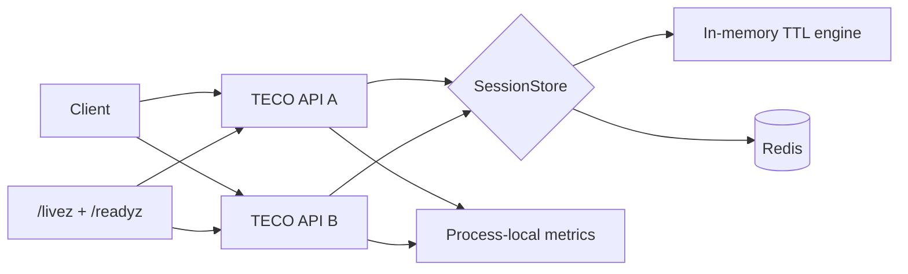

# TECO

[](https://github.com/jemeepatel045/TECO/actions/workflows/ci.yml)

**Thread-Less Ephemeral Context Orchestration** is a C++17 backend-systems project for short-lived, token-keyed session state.

TECO started as a small TTL engine and evolved into a complete local systems prototype with a REST API, interchangeable in-memory and Redis storage, multi-instance Docker deployment, metrics, benchmarking, health semantics, graceful shutdown, and automated failure/recovery testing.

> TECO is intentionally an educational systems prototype, not an internet-facing production HTTP server.

## What TECO demonstrates

- C++17 systems programming with POSIX sockets
- A small HTTP/1.1 server with bounded request parsing
- Token-keyed ephemeral session state with TTL behavior
- Storage abstraction with in-memory and Redis backends
- Shared state across multiple TECO processes through Redis
- Docker Compose deployment with two API instances and one Redis service
- Liveness and dependency-aware readiness probes
- Graceful `SIGINT` / `SIGTERM` shutdown
- Process-local request metrics and latency percentiles
- Repeatable local load testing
- Redis outage and recovery validation
- CMake, CTest, Python integration tests, and GitHub Actions CI

## Architecture



The server is single-threaded and handles one accepted connection at a time. The storage interface lets the HTTP layer use either the in-memory TTL engine or Redis without changing the API surface.

For a deeper walkthrough, see [docs/ARCHITECTURE.md](docs/ARCHITECTURE.md).

## Quick start with Docker

Requirements:

- Docker Desktop
- Docker Compose

Start the complete Redis-backed deployment:

```sh
docker compose up --build -d
docker compose ps
```

Verify both TECO instances:

```sh
curl -fsS http://127.0.0.1:8080/readyz
curl -fsS http://127.0.0.1:8081/readyz
```

Create a session through instance A:

```sh
curl -i -X POST http://127.0.0.1:8080/sessions \
  -H 'Content-Type: application/json' \
  -d '{"token":"demo_1","state":"ACTIVE"}'
```

Read the same session through instance B:

```sh
curl -i http://127.0.0.1:8081/sessions/demo_1
```

Stop the stack:

```sh
docker compose down
```

See [docs/DEMO.md](docs/DEMO.md) for a short portfolio demonstration.

## Build from source

Requirements:

- C++17 compiler
- CMake 3.16+
- Python 3.8+
- Redis for Redis integration tests

```sh
cmake -S . -B build -DCMAKE_BUILD_TYPE=Release
cmake --build build
ctest --test-dir build --output-on-failure
```

If Redis is unavailable, the Redis integration test exits with CTest's configured skip code. GitHub Actions provides Redis automatically for CI.

## Run locally

In-memory backend:

```sh
./build/teco_server --port 8080 --backend memory --ttl-ms 300000
```

Redis backend:

```sh
./build/teco_server \
  --port 8080 \
  --backend redis \
  --redis-host 127.0.0.1 \
  --redis-port 6379 \
  --ttl-ms 300000
```

Configuration can also come from environment variables:

| Variable | Purpose | Default |
| --- | --- | --- |
| `TECO_PORT` | HTTP port | `8080` |
| `TECO_TTL_MS` | Session TTL in milliseconds | `300000` |
| `TECO_BACKEND` | `memory` or `redis` | `memory` |
| `TECO_REDIS_HOST` | Redis hostname | `127.0.0.1` |
| `TECO_REDIS_PORT` | Redis port | `6379` |
| `TECO_REDIS_PREFIX` | Redis key prefix | `teco:session:` |
| `TECO_BIND_ALL` | Bind all interfaces when set to `1` | loopback only |
| `TECO_LOG_JSON` | Emit JSON request logs when set to `1` | disabled |

Explicit command-line flags override environment defaults.

## API

| Method | Route | Purpose |
| --- | --- | --- |
| `POST` | `/sessions` | Create or update a session |
| `GET` | `/sessions/{token}` | Read an active session |
| `DELETE` | `/sessions/{token}` | Delete a session |
| `GET` | `/health` | Compatibility health endpoint |
| `GET` | `/livez` | Process liveness |
| `GET` | `/readyz` | Backend-aware readiness |
| `GET` | `/metrics` | Process-local telemetry |

Example request:

```sh
curl -i -X POST http://127.0.0.1:8080/sessions \
  -H 'Content-Type: application/json' \
  -d '{"token":"alice","state":"ACTIVE"}'
```

## Health and failure behavior

`/livez` only checks that the TECO HTTP process can respond.

`/readyz` checks whether the configured backend can serve traffic. In Redis mode it performs a Redis `PING`:

- Redis available: `200 {"status":"ready"}`
- Redis unavailable: `503 {"status":"not_ready","backend":"redis"}`
- `/livez` remains `200` during the Redis outage

The Docker image health check uses `/readyz`, so container health reflects dependency readiness.

TECO converts Redis runtime failures into HTTP `503` responses instead of terminating the process.

## Observability

`GET /metrics` exposes process-local telemetry including:

- total requests
- 2xx, 4xx, and 5xx response counts
- process uptime
- process-average request rate
- bounded recent latency samples
- average latency
- P50, P95, and P99 latency
- resident session count
- in-memory TTL eviction count

Redis expiration is performed by Redis itself, so Redis `ttl_evictions` is reported as `null`.

Optional structured request logging:

```sh
TECO_LOG_JSON=1 ./build/teco_server --port 8080
```

## Benchmark snapshot

The repository includes a repeatable local session-read benchmark.

Captured local result using 1,000 requests, concurrency 8, and 25 warmup requests:

| Backend | Throughput | Avg latency | P50 | P95 | P99 | Errors |
| --- | ---: | ---: | ---: | ---: | ---: | ---: |
| In-memory | 5952.92 req/s | 1.312 ms | 1.258 ms | 1.816 ms | 2.469 ms | 0 |
| Redis | 2535.68 req/s | 3.114 ms | 2.988 ms | 3.958 ms | 6.118 ms | 0 |

These are machine-specific local measurements, not universal performance claims. The in-memory run is native while the Redis comparison uses the Docker deployment, so the result is useful as a project snapshot rather than a strict backend microbenchmark.

Run it yourself:

```sh
./benchmarks/run_comparison.sh
```

See [BENCHMARKS.md](BENCHMARKS.md) for methodology and `benchmarks/latest_results.txt` for the captured output.

## Resilience test

Run the end-to-end Docker failure/recovery scenario:

```sh
python3 tests/test_docker_resilience.py
```

It validates:

1. both TECO instances become ready
2. cross-instance session sharing works
3. Redis is stopped
4. `/readyz` changes to `503`
5. `/livez` remains `200`
6. Redis-dependent session traffic returns `503`
7. Redis is restarted
8. both TECO instances recover
9. cross-instance traffic works again
10. a TECO container exits cleanly after `SIGTERM`

See [RESILIENCE.md](RESILIENCE.md).

## Release verification

Before tagging a release:

```sh
./scripts/release_check.sh
```

This performs a Release build, runs the CTest suite, and executes the Docker resilience scenario.

## Project structure

```text
TECO/
├── .github/workflows/ci.yml
├── benchmarks/
│   ├── latest_results.txt
│   ├── load_test.py
│   └── run_comparison.sh
├── docs/
│   ├── ARCHITECTURE.md
│   └── DEMO.md
├── include/
│   ├── redis_store.hpp
│   ├── request_metrics.hpp
│   ├── session_store.hpp
│   └── teco_engine.hpp
├── scripts/
│   └── release_check.sh
├── src/
│   ├── main.cpp
│   └── server.cpp
├── tests/
│   ├── test_api.py
│   ├── test_docker_resilience.py
│   ├── test_engine.cpp
│   └── test_redis_api.py
├── BENCHMARKS.md
├── CHANGELOG.md
├── CMakeLists.txt
├── Dockerfile
├── LICENSE
├── README.md
├── RELEASE_NOTES_v1.0.0.md
├── RESILIENCE.md
└── compose.yaml
```

## Design decisions

**Single-threaded HTTP loop.** TECO intentionally keeps the server model simple so the project can focus on lifecycle, state, storage, metrics, and failure semantics.

**Storage abstraction.** `SessionStore` isolates API behavior from backend implementation.

**Redis TTL ownership.** Redis-backed sessions use Redis expiration rather than duplicating timer logic in each TECO process.

**Liveness vs readiness.** A running process can remain alive while its backend is unavailable. TECO exposes that distinction directly.

**No blind Redis retries.** A failed network operation can have an uncertain outcome. The prototype surfaces failure instead of automatically replaying commands whose effects may be ambiguous.

## Current limitations

TECO v1.0 is a portfolio systems prototype. It intentionally does not implement:

- TLS
- authentication or authorization
- a production HTTP parser
- persistent HTTP connections
- a thread pool or multi-core request execution
- Redis authentication or TLS
- Redis connection pooling
- Redis Cluster or Sentinel
- automatic Redis failover
- distributed metrics aggregation
- production rate limiting

The Redis metrics path also uses `KEYS` to count TECO-prefixed sessions, which is acceptable for this small local demo but not appropriate for a large production keyspace.

## Documentation

- [Architecture](docs/ARCHITECTURE.md)
- [Demo walkthrough](docs/DEMO.md)
- [Benchmark methodology](BENCHMARKS.md)
- [Resilience validation](RESILIENCE.md)
- [Changelog](CHANGELOG.md)
- [v1.0.0 release notes](RELEASE_NOTES_v1.0.0.md)

## License

See [LICENSE](LICENSE).

<!-- README render refresh -->

