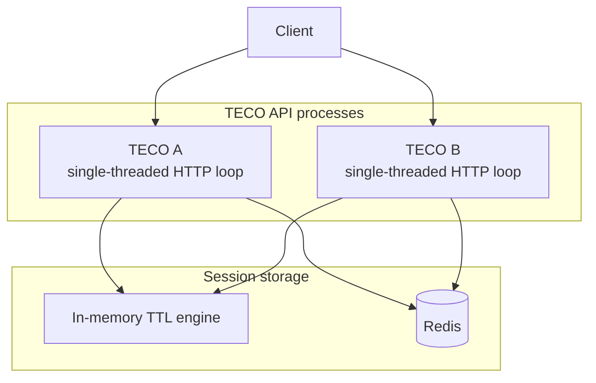
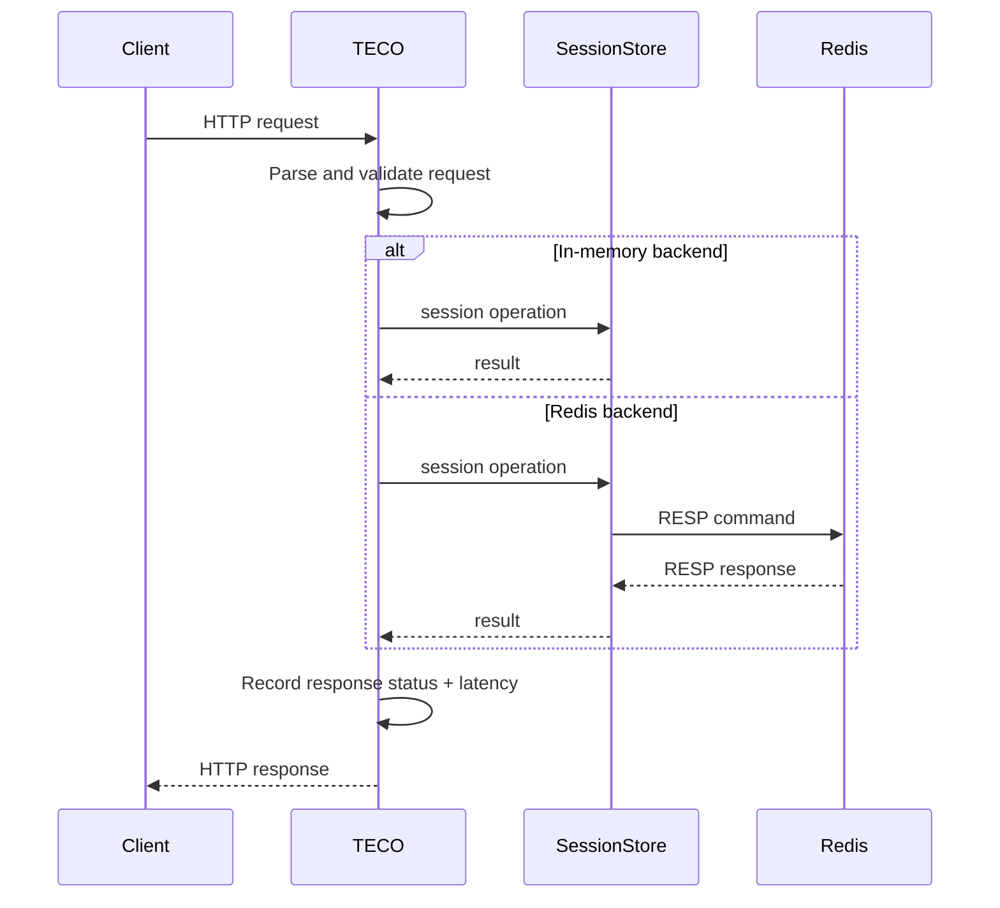
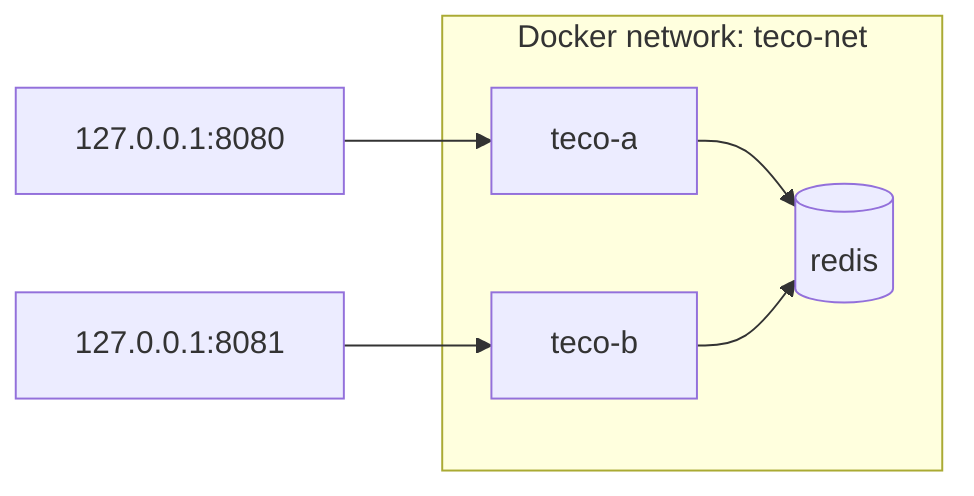

# TECO Architecture

## Overview

TECO is a C++17 backend-systems prototype for short-lived, token-keyed session state. The project separates HTTP handling from session storage through the `SessionStore` interface.



A process is configured for exactly one backend at startup. The Docker Compose demonstration runs two Redis-backed TECO processes connected to one Redis service.

## Main components

### `src/server.cpp`

The HTTP server:

- uses POSIX TCP sockets
- accepts HTTP/1.1 requests
- bounds request/header/body sizes
- supports one request per connection
- dispatches REST routes
- translates backend runtime failures into HTTP 503 responses
- records process-local request metrics
- handles `SIGINT` and `SIGTERM`
- exposes liveness and readiness probes

The server is intentionally single-threaded.

### `include/session_store.hpp`

`SessionStore` is the backend abstraction used by the API layer. It provides operations for:

- existence checks
- session writes
- session reads
- deletion
- resident-session reporting
- TTL-eviction reporting
- backend identification

`InMemorySessionStore` adapts the original TECO TTL engine to that interface.

### `include/redis_store.hpp`

`RedisSessionStore` implements shared session state through Redis.

The included RESP client:

- resolves the configured Redis host
- opens a TCP connection per command
- sends RESP commands
- parses basic Redis response types
- applies socket timeouts
- exposes `PING` for readiness checks

Writes use Redis `SET ... PX`, so Redis owns expiration.

### `include/request_metrics.hpp`

Metrics are process-local. TECO tracks:

- request count
- response-class counts
- uptime
- lifetime process-average RPS
- a bounded recent latency sample window
- average, P50, P95, and P99 latency

These metrics are diagnostic rather than distributed/aggregated telemetry.

## Request lifecycle



## Session semantics

### In-memory

The in-memory backend stores state in the TECO process. Sessions use TTL-based expiration with lazy lookup eviction and periodic sweep behavior implemented by the core engine.

State is not shared between separate in-memory TECO processes.

### Redis

Redis-backed sessions use keys under the configured prefix:

```text
teco:session:<token>
```

Writes use a Redis TTL. Reads do not refresh TTL. Multiple TECO processes using the same Redis instance and prefix observe the same session state.

## Health semantics

TECO deliberately distinguishes process health from dependency health.

### `/livez`

Returns HTTP 200 if the TECO HTTP process can serve the probe. It does not contact Redis.

### `/readyz`

For the in-memory backend, TECO is ready when the process is serving requests.

For the Redis backend, TECO issues `PING`. A successful `PONG` produces HTTP 200; backend failure produces HTTP 503.

The Docker image health check uses `/readyz`.

## Failure behavior

When Redis becomes unavailable after startup:

1. the TECO process remains alive
2. `/livez` continues to return 200
3. `/readyz` returns 503
4. Redis-dependent session operations return 503
5. the process can recover when Redis becomes reachable again

The server does not blindly replay failed Redis commands because a network failure may leave command outcome uncertain.

## Shutdown behavior

`SIGINT` and `SIGTERM` set a shutdown flag. The accept loop polls with a timeout so an idle process can observe the flag. After the active request completes, the server closes its listening socket and exits successfully.

This behavior is tested through Docker stop/SIGTERM in `tests/test_docker_resilience.py`.

## Docker topology



Redis is not published to the host by `compose.yaml`. Both API ports are published only on host loopback.

## CI validation

GitHub Actions contains two logical checks:

1. **build-and-test**
   - configure CMake
   - build
   - run CTest
   - use a Redis service container for integration tests

2. **docker-resilience**
   - build the Docker Compose stack
   - validate readiness
   - verify cross-instance state
   - stop Redis
   - verify readiness/liveness split
   - restart Redis
   - verify recovery
   - stop a TECO container and verify clean exit

## Security and production boundaries

TECO is not designed to be exposed directly to the public internet. The project intentionally omits TLS, authentication, authorization, production HTTP parsing, rate limiting, Redis authentication/TLS, pooling, replication, Cluster/Sentinel support, and distributed metrics.

The default host build binds to loopback. Container-wide binding requires the explicit `TECO_BIND_ALL=1` setting used by Docker Compose.
